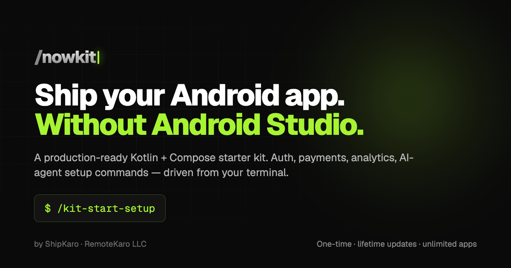

<h1 align="center">🛡️ Play Data Safety</h1>
<h4 align="center">Fill Google Play's Data safety form from your Android app's real code, not from memory.<br/>An agent skill and <code>/data-safety</code> command for Claude Code, Gemini CLI, Codex, Cursor, OpenCode and Antigravity.</h4>
<div align="center"><a href="https://twitter.com/intent/tweet?url=https%3A%2F%2Fgithub.com%2Fwajahatkarim3%2Fplay-data-safety-skill&text=Fill%20Google%20Play%27s%20Data%20safety%20form%20from%20your%20Android%20app%27s%20real%20code%2C%20not%20from%20memory.%20Free%20agent%20skill%20for%20Claude%20Code%2C%20Gemini%20CLI%2C%20Codex%20and%20Cursor&hashtags=android%2Cgoogleplay%2Cai%2Copensource">
        
    </a> <a href="https://twitter.com/WajahatKarim">
        
    </a>
</div>
<br/>

<div align="center">
    
    
    
    <!-- PRs Welcome -->
    <a href="#-how-to-contribute">
        
    </a>
    <!-- Say Thanks! -->
    <a href="https://saythanks.io/to/wajahatkarim3">
        
    </a>
</div>

<div align="center">
  <sub>Built with ❤︎ by
  <a href="https://twitter.com/WajahatKarim">Wajahat Karim</a> and
  <a href="https://github.com/wajahatkarim3/play-data-safety-skill/graphs/contributors">
    contributors
  </a>
</div>
<br/>
<br/>

It scans your Android project, asks you only what code can't reveal, and writes the CSV that
Play Console imports in one click.

- **Free and open source** (MIT). No account, no API key, no paid tool.
- **No changes to your app.** Nothing to add to Gradle. It runs your project's own Gradle from outside.
- **Evidence for every answer.** Each SDK entry cites the vendor's own Data safety page and the date it was checked.
- **Needs only JDK 17+**, which every Android developer already has.

> ⚠️ The output is a **draft for you to confirm**, not legal advice. Static analysis can't know what
> your server stores, whether a field is optional, or how deletion works. That's why it asks.

<br/>

## 🤔 Why

Every app on Google Play must complete the Data safety form: 13 categories, 38 data types, and seven
questions for each type you declare. The answers have to cover what your code **and every library
it pulls in** collect. Most developers fill it in once, from memory, and never touch it again,
until a new SDK makes it wrong and Play rejects an update.

<br/>

## 💻 Installation

Clone once, then install into your Android project (or `--global` for all projects):

```bash
git clone https://github.com/wajahatkarim3/play-data-safety-skill
cd your-android-app
/path/to/play-data-safety-skill/install.sh                 # every supported agent
/path/to/play-data-safety-skill/install.sh --agent gemini  # or just one
/path/to/play-data-safety-skill/install.sh --global        # into your home folder
```

| Agent | Skill goes to | Command |
|---|---|---|
| Claude Code | `.claude/skills/` | `/data-safety` |
| Gemini CLI | `.gemini/skills/` (skills are experimental; enable in settings) | `/data-safety` |
| Codex | `.codex/skills/` | `$play-data-safety` · `/prompts:data-safety` with `--global` |
| Cursor | `.agents/skills/` | `/data-safety` |
| OpenCode | `.opencode/skills/` | `/data-safety` |
| Antigravity | `.agents/skills/` | `/data-safety` workflow |

<br/>

## ❓ Usage

In your Android project, ask your agent:

> Fill my Play data safety form

or run `/data-safety`. The agent will:

1. **Scan** the project: every library (including transitive ones, via `./gradlew dependencies`),
   every permission in your manifests, and code that touches location, contacts, camera, audio,
   files, device IDs or the network.
2. **Match** libraries against the SDK table below, check each one is actually switched on, and show
   what it collects, with sources.
3. **Ask** only what it can't know: does this permission's data leave the device? What does your
   backend receive? Can users opt out of analytics? Where do they request deletion?
4. **Write** `play-data-safety/play_data_safety.md` (readable answers) and
   `play-data-safety/play_data_safety.csv`.
5. Tell you to import it: Play Console → *Set up your app* → **Data safety** → **Import from CSV**.

The CSV generator refuses to write a file it can't stand behind: unknown data type labels,
unanswered questions, a missing deletion URL, or a mismatch between the table and the CSV all stop it.

### Without an agent

The scripts work on their own:

```bash
SKILL=/path/to/play-data-safety-skill/skills/play-data-safety
java $SKILL/scripts/Scan.java . --skill-dir $SKILL                   # writes play-data-safety/scan.md
# edit play-data-safety/play_data_safety.draft.md → play_data_safety.md
java $SKILL/scripts/DataSafetyCsv.java play-data-safety/play_data_safety.md \
     $SKILL/reference/play-data-safety-template.csv play-data-safety/play_data_safety.csv
```

### In CI

Fail the build when a new SDK collects a data type your declaration doesn't list:

```bash
java $SKILL/scripts/Scan.java . --skill-dir $SKILL --check play-data-safety/play_data_safety.md
```

Exit code `4` means something is undeclared.

<br/>

## 🚀 Ship the Rest of Your Android App with NowKit

<a href="https://kit.shipkaro.dev"></a>

This skill comes from [**NowKit**](https://kit.shipkaro.dev), a production-ready Kotlin + Compose
starter kit driven by AI-agent commands. It does everything around the Data safety form too: auth,
payments and analytics setup, a privacy policy and terms generated from your code, a hosted landing
page, signing, screenshots, store listing, and a step-by-step guide through every Play Console screen
to production.

👉 **[kit.shipkaro.dev](https://kit.shipkaro.dev)**

<br/>

## 📦 SDKs Covered

38 SDKs, each mapped to Play's data types with the vendor's own source:

- **Google:** Firebase (Analytics, Crashlytics, Performance, Messaging, Auth, Firestore, Remote Config), AdMob, Play Billing, Sign in with Google, Maps, Places, ML Kit
- **Analytics & monitoring:** PostHog, Sentry, Amplitude, Mixpanel, Segment, BugSnag, Datadog, Luciq (Instabug)
- **Engagement:** Braze, CleverTap, Airship, OneSignal, Intercom
- **Ads & attribution:** Meta (Facebook SDK, Audience Network), Unity Ads, AppLovin, ironSource, AppsFlyer, Adjust, Branch
- **Payments & backend:** RevenueCat, Adapty, Stripe, Supabase

<details>
<summary><b>See every SDK with its source, role and confidence</b></summary>
<br/>

<!-- SDK-TABLE:START -->
38 SDKs.

| SDK | Vendor | Role | Confidence | Checked |
|---|---|---|---|---|
| [Adapty Android SDK](https://adapty.io/docs/google-play-data-safety) | Adapty | Service provider | high | 2026-11-13 |
| [Adjust Android SDK](https://help.adjust.com/en/article/google-play-data-safety) | Adjust | Service provider | high | 2026-11-13 |
| [Airship Android SDK](https://www.airship.com/docs/reference/data-collection/google-play-data-safety/) | Airship | Service provider | high | 2026-11-13 |
| [Amplitude Analytics (Android)](https://amplitude.com/docs/sdks/analytics/android/android-kotlin-sdk) | Amplitude | Service provider | medium | 2026-11-13 |
| [AppLovin MAX / AppLovin SDK](https://legal.applovin.com/privacy/) | AppLovin (Axon) | Shares data | low | 2026-11-13 |
| [AppsFlyer Android SDK](https://support.appsflyer.com/hc/en-us/articles/4417197430289-Fill-out-Google-safety-section-form) | AppsFlyer | Service provider | high | 2026-11-13 |
| [Branch Android SDK](https://help.branch.io/answering-the-google-play-store-privacy-questions) | Branch Metrics | Depends | high | 2026-11-13 |
| [Braze Android SDK](https://www.braze.com/docs/developer_guide/analytics/managing_data_collection?sdktab=android) | Braze | Service provider | high | 2026-11-13 |
| [BugSnag Android](https://docs.bugsnag.com/platforms/android/playstore-privacy/) | SmartBear (BugSnag) | Service provider | high | 2026-11-13 |
| [CleverTap Android SDK](https://developer.clevertap.com/docs/google-playstore-data-safety) | CleverTap | Service provider | medium | 2026-11-13 |
| [Cloud Firestore](https://firebase.google.com/docs/android/play-data-disclosure) | Google | Service provider | high | 2026-11-13 |
| [Datadog Android SDK (RUM, Logs, Trace, Session Replay)](https://docs.datadoghq.com/real_user_monitoring/android/data_collected/) | Datadog | Service provider | medium | 2026-11-13 |
| [Facebook SDK for Android (App Events, Login, Share)](https://developers.facebook.com/blog/post/2022/07/18/resources-for-completing-app-store-data-practice-questionnaires-apps-facebook-or-audience-network-sdk) | Meta | Shares data | medium | 2026-11-13 |
| [Firebase Authentication](https://firebase.google.com/docs/android/play-data-disclosure) | Google | Service provider | high | 2026-11-13 |
| [Firebase Cloud Messaging](https://firebase.google.com/docs/android/play-data-disclosure) | Google | Service provider | high | 2026-11-13 |
| [Firebase Crashlytics](https://firebase.google.com/docs/android/play-data-disclosure) | Google | Service provider | high | 2026-11-13 |
| [Firebase Performance Monitoring](https://firebase.google.com/docs/android/play-data-disclosure) | Google | Service provider | high | 2026-11-13 |
| [Firebase Remote Config](https://firebase.google.com/docs/android/play-data-disclosure) | Google | Service provider | high | 2026-11-13 |
| [Google Analytics for Firebase](https://support.google.com/analytics/answer/11582702) | Google | Service provider | high | 2026-11-13 |
| [Google Mobile Ads SDK (AdMob)](https://developers.google.com/admob/android/privacy/play-data-disclosure) | Google | Shares data | high | 2026-11-13 |
| [Google Play Billing Library](https://support.google.com/googleplay/android-developer/answer/10787469) | Google | Service provider | low | 2026-11-13 |
| [Intercom Android SDK](https://www.intercom.com/help/en/articles/7669340-mobile-sdk-faqs) | Intercom | Service provider | low | 2026-11-13 |
| [Luciq (formerly Instabug) Android SDK](https://docs.luciq.ai/android/set-up-luciq-for-android/logs-and-profiling/report-logs-for-android) | Luciq (formerly Instabug) | Service provider | low | 2026-11-13 |
| [Maps SDK for Android](https://developers.google.com/maps/documentation/android-sdk/play-data-disclosure) | Google | Service provider | medium | 2026-11-13 |
| [Meta Audience Network SDK](https://developers.facebook.com/blog/post/2022/07/18/resources-for-completing-app-store-data-practice-questionnaires-apps-facebook-or-audience-network-sdk) | Meta | Shares data | medium | 2026-11-13 |
| [Mixpanel Android SDK](https://docs.mixpanel.com/docs/tracking-methods/sdks/android) | Mixpanel | Service provider | medium | 2026-11-13 |
| [ML Kit (on-device)](https://developers.google.com/ml-kit/android-data-disclosure) | Google | Service provider | high | 2026-11-13 |
| [OneSignal Android SDK](https://documentation.onesignal.com/docs/google-play-data-safety-requirements) | OneSignal | Service provider | high | 2026-11-13 |
| [Places SDK for Android](https://developers.google.com/maps/documentation/places/android-sdk/play-data-disclosure) | Google | Service provider | medium | 2026-11-13 |
| [PostHog Android SDK](https://posthog.com/docs/libraries/android) | PostHog | Service provider | medium | 2026-11-13 |
| [RevenueCat Purchases SDK](https://www.revenuecat.com/docs/platform-resources/google-platform-resources/google-plays-data-safety) | RevenueCat | Service provider | high | 2026-11-13 |
| [Segment Analytics (Analytics-Kotlin and legacy Analytics-Android)](https://www.twilio.com/docs/segment/connections/sources/catalog/libraries/mobile/kotlin-android) | Twilio Segment | Service provider | medium | 2026-11-13 |
| [Sentry Android SDK](https://docs.sentry.io/security-legal-pii/security/mobile-privacy/) | Sentry | Service provider | medium | 2026-11-13 |
| [Sign in with Google (Credential Manager googleid / legacy Google Sign-In)](https://developer.android.com/identity/sign-in/credential-manager-siwg) | Google | Service provider | low | 2026-11-13 |
| [Stripe Android SDK (PaymentSheet, payments-core, Financial Connections, Identity, CardScan)](https://support.stripe.com/questions/stripe-mobile-sdk-privacy-details) | Stripe | Service provider | medium | 2026-11-13 |
| [Supabase Kotlin client (supabase-kt)](https://github.com/supabase-community/supabase-kt) | Supabase community (Jan Tennert) / Supabase | Service provider | low | 2026-11-13 |
| [Unity Ads](https://docs.unity.com/en-us/grow/ads/privacy/google-data-safety) | Unity Technologies | Shares data | high | 2026-11-13 |
| [Unity LevelPlay (ironSource Mediation)](https://docs.unity.com/grow/levelplay/platform/legal-resources/google-data-safety-questionnaire) | Unity Technologies (ironSource) | Shares data | high | 2026-11-13 |
<!-- SDK-TABLE:END -->

</details>


A library that isn't listed is reported as **unknown** and the agent helps you check its docs.
Please contribute the entry back.

<br/>

## 👨 Developed By

<a href="https://twitter.com/WajahatKarim" target="_blank">
  
</a>

**Wajahat Karim**, Google Developer Expert for Android

[](https://twitter.com/WajahatKarim)
[](https://wajahatkarim.com/)
[](https://medium.com/@wajahatkarim3)
[](https://www.linkedin.com/in/wajahatkarim/)

<br/>

## 👍 How to Contribute

The most valuable contribution is an SDK entry. Add `skills/play-data-safety/sdks/<id>.json`
following [`sdks/SCHEMA.md`](skills/play-data-safety/sdks/SCHEMA.md). Every data type needs a
`sourceUrl` from the vendor's own documentation and a `checked` date. PRs that update a stale entry
are just as welcome as new ones. Check your entry with:

```bash
java tools/ValidateSdks.java
```

1. Fork it
2. Create your feature branch (git checkout -b my-new-feature)
3. Commit your changes (git commit -am 'Add some feature')
4. Push to the branch (git push origin my-new-feature)
5. Create new Pull Request

<br/>

## 📃 License

    Copyright 2026 Wajahat Karim

    Licensed under the MIT License. See the LICENSE file for details.

`skills/play-data-safety/reference/play-data-safety-template.csv` is Google Play Console's sample
Data safety import file, included so the generated CSV matches Play's schema.
